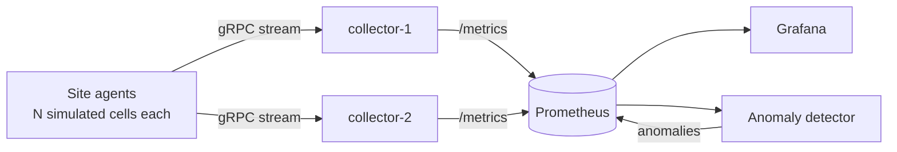

<div align="center">

# 📡 CellPulse

**Distributed telemetry for simulated 5G radio cells**

[](https://github.com/not-clover/distributed-telemetry/actions/workflows/ci.yml)
[](https://github.com/not-clover/distributed-telemetry/actions/workflows/codeql.yml)
[](https://github.com/not-clover/distributed-telemetry/releases)
[](LICENSE)

</div>

CellPulse simulates fleets of 5G radio cells across several sites. Each cell streams radio KPIs
(throughput, PRB utilisation, latency, drop rate, …) over gRPC to a horizontally scaled
collector tier. From there the data is scraped by Prometheus, visualised in Grafana, and
checked continuously by an anomaly detector that flags degraded cells.

> 🚧 **Status:** in active development. Target v1.0.0 on **2 Dec 2026**.
> Follow progress on the [Project board](../../projects) and the [Wiki](../../wiki).

<!-- TODO(v1.0): replace with demo GIF: compose up → dashboard → inject fault → anomaly flagged -->

## Architecture



| Component | What it does | Owner |
|-----------|--------------|-------|
| `cellpulse-agent` | Simulates cells at one site, with realistic daily patterns and fault injection | @not-clover |
| `cellpulse-collector` | gRPC ingest, Prometheus exposition, graceful scale-out | @not-clover |
| `cellpulse-detector` | Rolling-baseline anomaly detection on KPIs | @not-clover |
| `cellpulse-cli` | `status` and `load` tools for developers | @AnvikaVihaan |

Design decisions are recorded as [Architecture Decision Records](docs/adr).

## Quickstart

```bash
git clone https://github.com/not-clover/distributed-telemetry.git
cd distributed-telemetry
make dev      # venv + deps + generated protobuf code + git hooks
make test     # unit + integration tests
make up       # full stack in Docker
```

Grafana: <http://localhost:3000> · Prometheus: <http://localhost:9090>

## Tech stack

Python 3.12 · gRPC / Protocol Buffers · asyncio · Prometheus · Grafana · Docker Compose ·
GitHub Actions (CI, CodeQL, GHCR images, release-please)

## How we work

Two developers in two time zones (Sweden 🇸🇪 and India 🇮🇳)
The process is sized for that:

- **1-week sprints**, each mapped to a milestone, planned on the GitHub Project board
- **Async stand-ups** in Discussions, plus one 30-minute combined planning/review/retro call
- **Trunk-based development**: short-lived branches, squash-merged PRs, Conventional Commits
- Everything is in the open: [project plan](docs/PROJECT_PLAN.md), [sprint retros](../../wiki), [ADRs](docs/adr)

See [CONTRIBUTING.md](CONTRIBUTING.md).

## Future work

Kubernetes Helm chart · mTLS between agents and collectors · long-term storage (Thanos / VictoriaMetrics) ·
C++ agent for low-overhead edge deployment · OpenTelemetry exporter

## Licence

[MIT](LICENSE)
