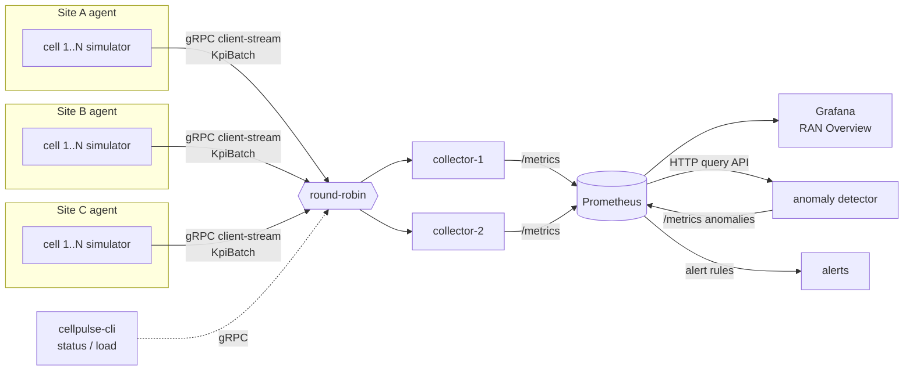

# CellPulse: Project Plan

> Distributed telemetry for simulated 5G radio cells.
> Timebox: **Thu 5 Nov 2026 → Wed 2 Dec 2026** (4 one-week sprints).

## 1. Goal and success criteria

**Product goal:** Many simulated 5G cells stream radio KPIs to a horizontally
scalable collector tier. The data is stored, visualised in Grafana, and checked
automatically for anomalies.

**Done on 2 Dec means:**

| # | Criterion | How we prove it |
|---|-----------|-----------------|
| 1 | `docker compose up` starts the whole system (3 sites × N cells, 2 collectors, Prometheus, Grafana, detector) | README quickstart + CI smoke test |
| 2 | System survives a collector restart without losing data from the last 30 s | Integration test + demo GIF |
| 3 | Detector flags injected faults (outage, congestion) within 30 s | Integration test |
| 4 | Load-test numbers published (msgs/s, p95 ingest latency vs. cell count) | Wiki page "Performance" |
| 5 | Visible process: board, 4 sprint retros, ADRs, reviewed PRs, tagged v1.0.0 release | GitHub itself |

**Out of scope (on purpose):** auth/TLS between services, Kubernetes deployment,
real radio data, a custom UI. These go in the "Future work" section of the README.
Cutting scope deliberately is part of what we show.

## 2. Team and capacity

| Person | Role | Availability | Planned capacity per sprint |
|--------|------|--------------|-----------------------------|
| Ishita (Karlstad, CET) | Product owner, Scrum master, lead dev | ~10 h/week on this project | **~10 points** |
| Partner (PES Bangalore, IST = CET + 4h30) | Developer (owns `cellpulse-cli`) + reviewer | 2 h/week | **~1.5 points** coding + ~30 min review |

**Estimation:** Fibonacci story points (1, 2, 3, 5, 8). To start, 1 point ≈ 1 focused hour.
We re-calibrate after Sprint 1 using actual velocity. Nothing above 5 enters a sprint;
anything bigger gets split.

**Overlap window:** 09:00–13:00 CET = 13:30–17:30 IST. The weekly sync goes here.

## 3. Ceremonies (sized for a 2-hour-a-week teammate)

| Ceremony | When | Length | Where |
|----------|------|--------|-------|
| Sprint planning + review + retro (combined) | Sundays, 10:00 CET / 14:30 IST | 30 min | Video call; notes in Wiki → `Sprint-N` |
| Async stand-up | Mon / Wed / Fri | 2 min to write | GitHub Discussions → *Standups* |
| Backlog refinement | Ishita alone, Saturdays | 30 min | Project board |
| Code review | Within 48 h of request | — | Pull requests |

Combining the ceremonies is a deliberate adaptation: a 2 h/week teammate cannot spend
1.5 h of it in meetings. Write this trade-off up in your CV and interview story.

## 4. Sprint plan

| Sprint | Dates | Milestone | Sprint goal |
|--------|-------|-----------|-------------|
| 0 | Thu 5 → Sun 8 Nov | `Sprint 0 · Foundations` | Repo, board, CI and API contract agreed; partner can run the project locally |
| 1 | Mon 9 → Sun 15 Nov | `v0.1 · Walking skeleton` | KPIs flow end-to-end: agent → gRPC → collector, all in Docker |
| 2 | Mon 16 → Sun 22 Nov | `v0.2 · Observability` | Scaled collectors, Prometheus + Grafana dashboard, CI smoke test |
| 3 | Mon 23 → Sun 29 Nov | `v0.3 · Resilience & intelligence` | Fault injection, anomaly detector, no data loss on collector restart |
| Release | Mon 30 Nov → Wed 2 Dec | `v1.0 · Release` | Docs, demo GIF, perf report, v1.0.0 tagged |

The full backlog with estimates and acceptance criteria is in
[`scripts/backlog.json`](../scripts/backlog.json). The setup script turns it into
GitHub Issues.

## 5. Architecture (target for v1.0)

Key decisions are recorded as ADRs in [`docs/adr`](adr).

## 6. Risks

| Risk | Likelihood | Impact | Mitigation |
|------|-----------|--------|------------|
| Partner's week gets busy, so CLI work stalls | High | Low | CLI is off the critical path; nothing depends on it. Ishita can descope `load` to a script |
| gRPC/protobuf learning curve | Medium | Medium | Sprint 0 spike; walking skeleton first |
| Scope creep (Kubernetes, ML models) | Medium | High | Out-of-scope list above; anything new goes to backlog label `icebox` |
| Exam period at uni | Medium | Medium | Sprint 3 holds the most points; at that point, cut `stretch`-labelled items first |
| Unreviewed PRs block progress | Medium | Medium | 48 h review rule, then the author may merge with a "post-merge review" note |

## 7. Definition of Ready / Done

**Ready:** user story format, acceptance criteria, estimate ≤ 5, no unresolved dependency.

**Done:**
- Code merged to `main` through a PR with green CI (lint, types, tests)
- New code has tests; coverage does not drop
- Docs/wiki updated if behaviour changed
- Acceptance criteria ticked in the issue
- Issue closed by the PR (`Closes #N`), and the card moves to *Done* automatically
